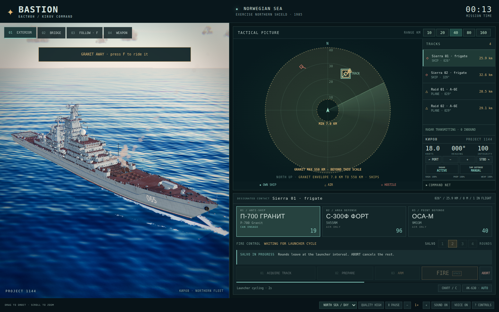

# Bastion



**Command a Soviet missile cruiser, the nuclear-powered Kirov or the Slava, through a fictional 1985 naval encounter, from her bridge or a third-person ship view.** The name is the Northern Fleet's 1980s strategy: hold the Barents Sea as a bastion for the missile submarines, with cruisers like these as its guard.

**Why it's different:** one moving ship carries several layers of air defense. Radar horizon, altitude limits, finite magazines and missile travel time shape the fight. The exterior and bridge use real photographs as modeling references.

## What you do

- **Choose your ship.** Kirov (Project 1144: 20 Granit, 96 Fort, 40 Osa) or Slava (Project 1164: 16 Bazalt in eight twin deck containers, 64 Fort, 40 Osa, a twin AK-130; half Kirov's size, so hits hurt more).
- **Strike ships.** Select hostile frigates and launch P-700 Granit or P-500 Bazalt anti-ship missiles.
- **Defend the ship.** Engage aircraft and incoming Harpoons with Fort, Osa and automatic AK-630 close-in guns.
- **Take command.** Change course and speed, control radar emissions and defensive automation, and deploy chaff.
- **Change perspective.** Watch from outside, look through the modeled bridge windows, or follow a missile.
- **Feel the sea.** Animated ship and crew, recorded ambient/combat audio, smoke and fire, with day, dusk, heavy-weather and night conditions.

## Play it

```bash
npm install
npm run dev
```

Open **http://localhost:5202** in a desktop browser with WebGL2. Build with `npm run build`; serve `dist/` over HTTP or upload its contents as an HTML game.

## Controls

`1` exterior · `2` bridge · `3` / `F` ride your missile (`Shift+F` an incoming one) · `4` launcher inspection · arrows helm/speed · `Enter` next fire-control step · `Space` authorize armed salvo · `Shift+1`-`4` salvo size · `R` radar · `A` auto SAM defense (starts manual) · `G` AK-630 auto/hold · `C` chaff · `P` pause · `H` hide view labels · `[` / `]` time. Use the radar and dedicated command panel: acquire a track, prepare, arm, then authorize a salvo. [All controls](docs/PLAYING.md).

## Status

Initial single-player scenario: two enemy frigates, aircraft attacks and multiple incoming missile waves, with mission success/failure and a debrief. Weapons use public characteristics with clearly identified game approximations. The bridge is reference-informed, not an exact surveyed reconstruction.

## Go deeper

- [How to play](docs/PLAYING.md)
- [What's modeled](docs/MODELLED.md)
- [History and sources](docs/HISTORY.md)
- [Development](docs/DEVELOPMENT.md)
- [Reference photo index](refs/README.md)

## More games

- [Battle Stations](https://github.com/drichards188/battlestations): man USS Alabama's anti-aircraft guns.
- [Echelon](https://github.com/drichards188/echelon): command a layered air defense.
- [Drumfire](https://github.com/drichards188/drumfire): command heavy artillery.

## Credits

Three.js and lil-gui (MIT); Vite (MIT); Playwright (Apache-2.0). Six bundled CC0 sound recordings and synthetic Russian crew callouts (Piper TTS, see licence notes): [credits](public/audio/CREDITS.md). Real photographs guide original procedural models; no reference photographs are shipped as game textures. US Navy exterior references are public-domain government works. Kirov bridge photographs are by Oleg Kuleshov / Korabel.ru, local reference only.

© 2026 David Richards. Source available under [PolyForm Strict 1.0.0](LICENSE); third-party libraries keep their own licenses.
